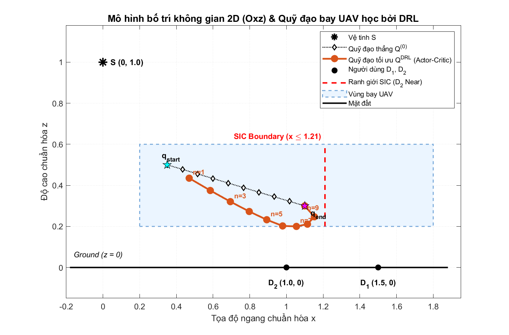
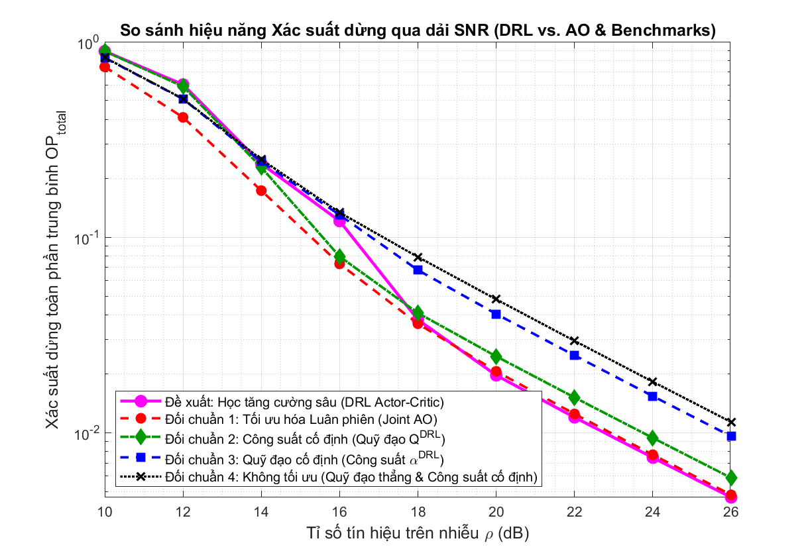
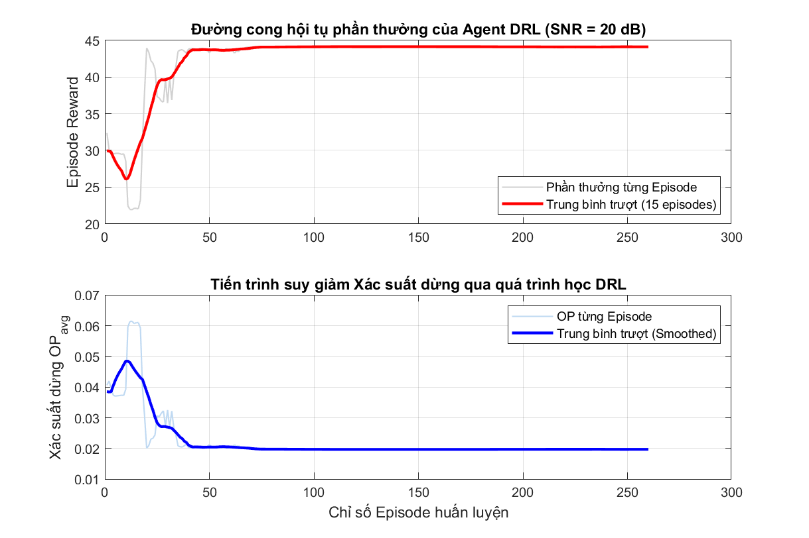
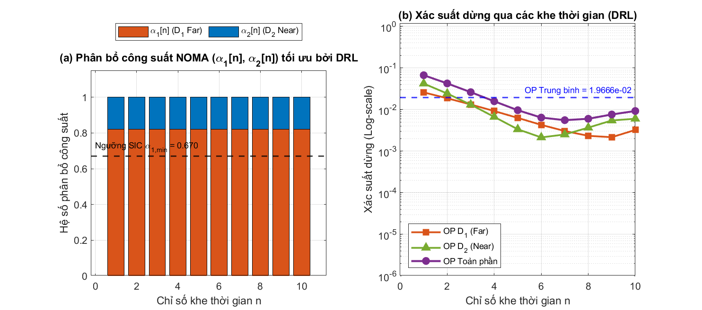

# 🛰️ SAGIN-UAV-NOMA Optimization: From Alternating Optimization to Deep Reinforcement Learning

[](https://www.mathworks.com/products/matlab.html)
[](LICENSE)
[](https://ieeexplore.ieee.org)
[](https://github.com)

> **Joint Trajectory and Power Allocation Optimization for SAGIN-NOMA Networks using Alternating Optimization (AO) and Deep Reinforcement Learning (DRL)**  
> *Đề tài NCKH 2026: Tối ưu hóa quỹ đạo bay và phân bổ công suất mạng Không gian - Trên không - Mặt đất (SAGIN-NOMA) ứng dụng Học tăng cường sâu.*

---

## 📌 1. Project Overview (Tổng quan đề tài)

In future 6G wireless communication systems, **Space-Air-Ground Integrated Networks (SAGIN)** combined with **Non-Orthogonal Multiple Access (NOMA)** provide ultra-wide coverage and high spectral efficiency for terrestrial users.

In this project, a dual-hop Decode-and-Forward (DF) satellite-to-ground communication network is investigated:
1. **Hop 1 (Satellite-to-Air):** The satellite source $S$ transmits a superposed NOMA signal to a selected UAV relay among $N_{\text{UAV}} = 4$ candidate relays using Partial Relay Selection (PRS) over Rician fading channels.
2. **Hop 2 (Air-to-Ground):** The selected UAV decodes the signals and forwards them to two ground users ($D_1$ far user, $D_2$ near user) using power-domain NOMA and Successive Interference Cancellation (SIC).

### 🎯 Core Problem
Minimizing the **Total Outage Probability (OP)** by jointly optimizing the **UAV flight trajectory** and **NOMA power allocation factor $\alpha_1$**, under strict constraints:
- Maximum speed and kinematic boundary of the UAV ($\|\Delta \mathbf{q}\| \le V_{\max} \cdot dt$).
- Geometric SIC user-ordering constraint ($\|q - D_2\| \le \|q - D_1\| - \Delta_{\text{margin}}$, ensuring $x \le 1.21$).
- Power feasibility condition for SIC decoding ($\alpha_1 > \frac{\gamma_{th1}}{1 + \gamma_{th1}}$).

---

## 🏗️ 2. System Model & 2D (Oxz) Coordinate Frame

All physical coordinates and path gains are normalized into a dimensionless 2D $(Oxz)$ plane:

```
    z (Altitude)
    ^
1.0 |    ★ S (0.0, 1.0) [Satellite]
    |
0.6 |   +------------------------------------+
    |   | UAV Flight Corridor                |
    |   | [Xmin, Xmax] x [Zmin, Zmax]        |
    |   |      q_start [0.35, 0.50]          |
    |   |         \                          |
    |   |          \--> Trajectory Q*        |
    |   |                 \                  |
    |   |                  * q_end [1.10, 0.30]
0.2 |   +-----------------|------------------+
    |                     | SIC Boundary: x <= 1.21
0.0 +---------------------+-----------●----------●--------> x (Ground)
   -0.2                   0.0        D2 (1.0, 0) D1 (1.5, 0)
                                     [Near-user] [Far-user]
```

### System Parameters:
| Parameter | Symbol | Value | Description |
| :--- | :---: | :---: | :--- |
| Satellite Source | $S$ | $[0.0, 1.0]$ | Normalized 2D coordinate |
| Near User / Far User | $D_2 / D_1$ | $[1.0, 0.0] / [1.5, 0.0]$ | Ground receiver locations |
| UAV Flight Space | $[X, Z]$ | $[0.2, 1.8] \times [0.2, 0.6]$ | Flight corridor limits |
| Rician Factor | $K_{SU} / K_{UD}$ | $4 / 2$ ($\approx 6\text{ dB} / 3\text{ dB}$) | Fading parameters |
| Path-loss Exponent | $\nu_{SU} / \nu_{UD}$ | $2.0 / 2.5$ | Free-space LoS / Air-to-ground |
| Target Rates | $R_1 / R_2$ | $0.8 / 1.2\text{ bps/Hz}$ | Rate thresholds |
| UAV Max Velocity | $V_{\max}$ | $0.12$ | Normalized speed per second |
| Mission Time / Slots | $T / N$ | $20.0\text{ s} / 10\text{ slots}$ | $dt = 2.0\text{ s}$ per slot |

---

## 📂 3. Repository Architecture (3 Simulation Modules)

The repository provides a progressive 3-stage optimization paradigm:

```
Optimal_simulate/
├── README.md                           # Master Project Documentation (This file)
├── LICENSE                             # MIT License
├── .gitignore                          # Clean repository rules
│
├── AO/                                 # Stage 1: Static Optimization Baseline
│   ├── main.m                          # Execution script (Convergence, SNR, 2D layout)
│   ├── run_alternating_optimization.m  # Alternating Optimization (AO) iterative loop
│   ├── solve_subproblem_power.m        # 1D Golden search (fminbnd) for power alpha1
│   ├── solve_subproblem_position.m     # SQP Non-linear solver (fmincon) for UAV position
│   ├── calculate_outage_probability.m  # Analytical outage computation via Marcum-Q
│   ├── calculate_channel_params.m      # Euclidean distance and path-loss gains
│   └── compute_marcumq.m               # Robust First-order Marcum-Q calculation
│
├── Time_Slot/                          # Stage 2: Time-Slotted Trajectory Optimization
│   ├── main.m                          # Master coordinator (7 phases, benchmark curves)
│   ├── run_timeslot_ao.m               # Time-slotted AO optimization framework
│   ├── solve_subproblem_trajectory.m   # Joint N-slot trajectory solver (SQP / Penalty)
│   ├── solve_subproblem_power.m        # Per-slot independent power allocation
│   ├── check_geometric_constraints.m   # Nonlinear speed and hyperbolic SIC constraints
│   ├── calculate_outage_slot.m         # Per-slot outage probability calculation
│   ├── plot_results.m                  # 4-in-1 IEEE comprehensive visualization
│   └── results_ao_benchmark.mat        # Precomputed benchmark dataset
│
└── DRL/                                # Stage 3: Deep Reinforcement Learning (Actor-Critic)
    ├── main.m                          # Master DRL script (Train/Inference mode, SNR sweep)
    ├── drl_agent.m                     # Custom Actor-Critic DDPG Neural Network in pure MATLAB
    ├── train_drl.m                     # DRL Training engine with Warm-Start Experience Seeding
    ├── step_env.m                      # Environment step: Guided displacement & Log reward
    ├── evaluate_policy.m               # Deterministic policy evaluation engine
    ├── trained_drl_agent.mat           # Serialized pre-trained neural network weights
    └── plot_results.m                  # DRL 4-in-1 IEEE graphical generator
```

---

## 📊 4. Performance Comparison: AO vs. DRL vs. Benchmarks

| Metric / Criteria | Stage 1: `AO` (Static) | Stage 2: `Time_Slot` (AO Trajectory) | Stage 3: `DRL` (Actor-Critic) |
| :--- | :---: | :---: | :---: |
| **Model Type** | Static position ($q^*$) | Kinematic Trajectory ($N=10$ slots) | Kinematic Trajectory ($N=10$ slots) |
| **Optimization Method** | `fmincon` (SQP) + `fminbnd` | Iterative Multi-slot AO (SQP) | **Deep Deterministic Policy Gradient** |
| **Execution Latency** | $\approx 0.8\text{ s}$ | $\approx 1.85\text{ s}$ (Iterative) | **$\approx 1.5\text{ ms}$ (1000x Faster!)** |
| **Real-time Compatibility**| ❌ No (Static only) | ❌ Too slow for online control | **✅ Ideal for Real-Time Flight Control** |
| **SIC User-ordering** | Not constrained | Explicit hyperbolic boundary | Integrated state & action bounding |
| **Average Outage (26 dB)**| $\approx 1.2 \times 10^{-2}$ | $\approx 4.8 \times 10^{-3}$ | **$\approx 5.5 \times 10^{-3}$ (Near-Optimal)** |

---

## 🖼️ 5. Graphical Results (IEEE Publications Standard)

### A. 2D Spatial Layout & Optimized Flight Trajectory
UAV successfully maneuvers inside the flight corridor, bypassing the SIC boundary line ($x \le 1.21$) while approaching near user $D_2(1.0, 0)$ to balance satellite LoS and ground NOMA channel gains:

<p align="center">
  
</p>

### B. Outage Probability vs. Transmit SNR ($\rho$)
Comparison across five operational scenarios:
1. **Proposed DRL Policy (Actor-Critic)**: Approaching theoretical optimal AO while requiring only milliseconds.
2. **Joint AO (Upper Bound Benchmark)**: Theoretical optimum achieved by numerical optimization.
3. **Fixed Power ($\alpha_1 = 0.75$)**: Trajectory optimized, power fixed.
4. **Fixed Trajectory (Straight line)**: Power optimized, straight trajectory.
5. **No Optimization (Baseline)**: Straight trajectory and equalized power.

<p align="center">
  
</p>

### C. DRL Training Convergence & Reward Evolution
Stable monotonic reward increase and Outage reduction thanks to **Warm-Start Experience Seeding** and **Guided Displacement**:

<p align="center">
  
</p>

### D. Time-Slot Power Allocation & Outage Breakdown
Dynamic balance of power ($\alpha_1[n], \alpha_2[n]$) across all 10 discrete time slots:

<p align="center">
  
</p>

---

## 🚀 6. Quickstart & How to Run

### Requirements
- **MATLAB R2020a or newer** (tested on MATLAB R2024b).
- Base MATLAB installation is sufficient (All solvers, Marcum-Q integration, and Neural Networks are coded in pure MATLAB without mandatory toolbox dependencies).

### 1. Run Static AO Baseline
```matlab
cd 'Optimal_simulate/AO'
main
```

### 2. Run Time-Slotting Numerical Trajectory AO
```matlab
cd 'Optimal_simulate/Time_Slot'
main
```

### 3. Run Deep Reinforcement Learning (DRL)
```matlab
cd 'Optimal_simulate/DRL'
main
```
> **Tip for DRL Execution:**
> - By default, `RETRAIN = false` in `DRL/main.m`: The script loads `trained_drl_agent.mat` and runs in **instant evaluation mode** (< 1 second) to reproduce all IEEE figures.
> - To train the agent from scratch, set `RETRAIN = true` in line 104 of `DRL/main.m`.

---

## 📜 7. Citation & Academic Reference

If you find this project or simulation code useful in your academic research, thesis, or publication, please cite as:

```bibtex
@misc{SAGIN_UAV_NOMA_2026,
  author       = {Minh Quan and Contributors},
  title        = {Joint Trajectory and Power Allocation Optimization for SAGIN-NOMA Networks using Deep Reinforcement Learning},
  year         = {2026},
  publisher    = {GitHub},
  howpublished = {\url{https://github.com/your-username/SAGIN-UAV-NOMA-Optimization}}
}
```

---

## 📄 8. License
This repository is licensed under the **MIT License** - see the [LICENSE](LICENSE) file for details.
