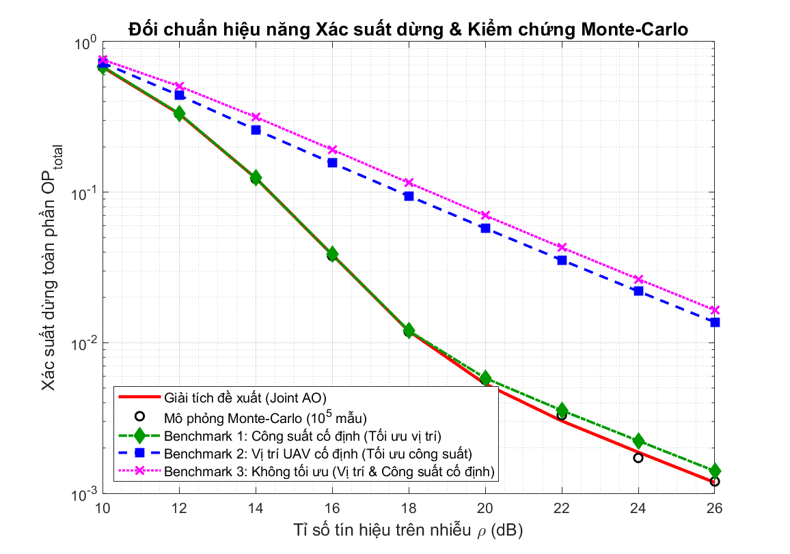
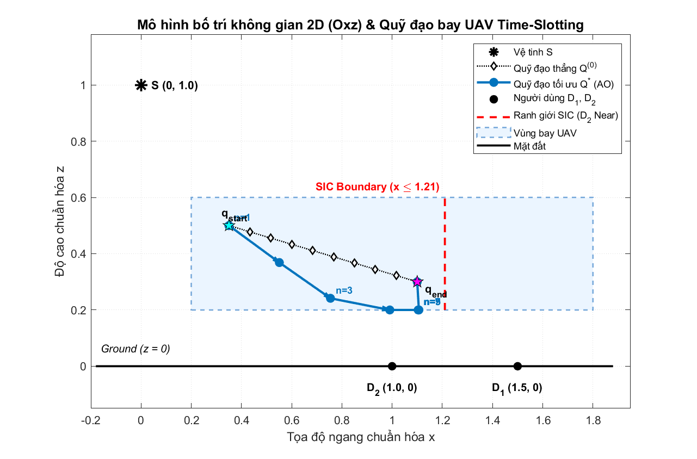
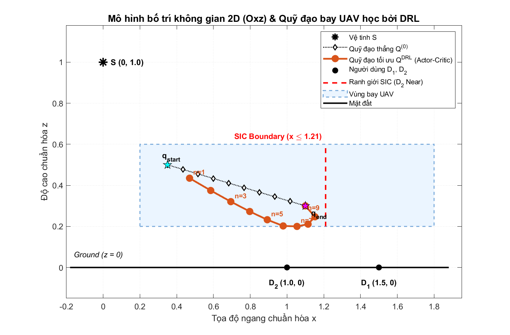
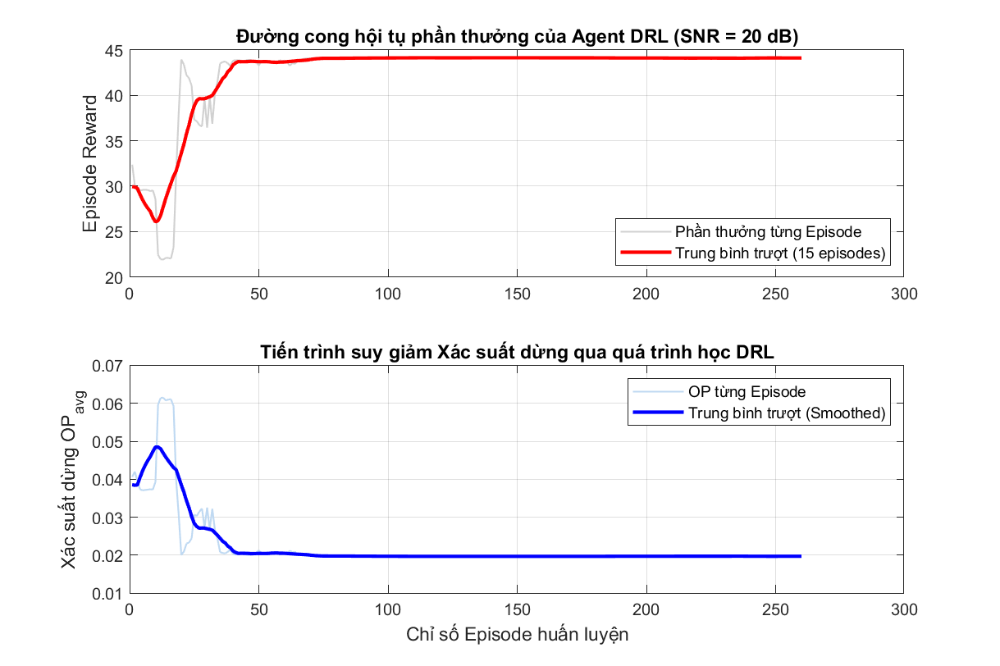

# Tối ưu hóa Đồng thời Quỹ đạo bay và Phân bổ Công suất trong Mạng SAGIN-NOMA (AO vs. DRL)

> **Mã nguồn và Báo cáo Kỹ thuật Đề tài NCKH:** Đánh giá hiệu năng và tối ưu hóa hệ thống truyền thông tích hợp Không gian - Trên không - Mặt đất (SAGIN) hỗ trợ Đa truy nhập phi trực giao (NOMA) trên kênh fading Rician tổng quát: So sánh đối chuẩn giữa Tối ưu hóa Luân phiên (Alternating Optimization - AO) và Học tăng cường sâu (Deep Reinforcement Learning - DRL) thời gian thực.

---

## 1. Mục tiêu Nghiên cứu

Nghiên cứu tập trung giải quyết bài toán tối ưu hóa liên hợp giữa **quỹ đạo bay động học** của Phương tiện bay không người lái (UAV) và **phân bổ hệ số công suất phát** NOMA trong mạng SAGIN hai chặng (Vệ tinh nguồn $\to$ Cụm tiếp sóng UAV với cơ chế Lựa chọn Chuyển tiếp Từng phần PRS $\to$ Hai người dùng mặt đất $D_1, D_2$). Mục tiêu cốt lõi là **cực tiểu hóa xác suất dừng toàn phần hệ thống (System Outage Probability - $OP_{\text{total}}$)** trên toàn bộ hành trình $N=10$ khe thời gian, đồng thời tuân thủ nghiêm ngặt các ràng buộc vận tốc tối đa, hành lang bay an toàn và **ranh giới hình học Khử can nhiễu liên tiếp (SIC)**.

Tài liệu báo cáo kỹ thuật chi tiết (16 trang chuẩn IEEE) được lưu trữ tại: [`docs/Bao_Cao_Chuyen_Mon_SAGIN_NOMA.pdf`](docs/Bao_Cao_Chuyen_Mon_SAGIN_NOMA.pdf).

---

## 2. Kiến trúc Hệ thống & Hình học 2D $(Oxz)$

Hệ thống được mô hình hóa trong không gian 2D chuẩn hóa $(Oxz)$ với khoảng cách tham chiếu $D_0 = 125\text{ m}$:
* **Vệ tinh nguồn ($S$):** Tọa độ $\mathbf{q}_S = (0.0, 1.0)$, truyền tín hiệu đường xuống tới cụm tiếp sóng UAV.
* **Cụm tiếp sóng UAV ($N_{\text{UAV}} = 3$):** Bay theo đội hình cụm lân cận. Cơ chế PRS chọn ra UAV có độ lợi kênh tức thời $|h_{SU_k}|^2$ tốt nhất để thu và giải mã tín hiệu. UAV di chuyển từ $\mathbf{q}_{\text{start}} = (0.35, 0.50)$ về đích $\mathbf{q}_{\text{end}} = (1.10, 0.30)$ qua $N=10$ khe ($T=20\text{ s}$, $dt=2\text{ s}$). Bước dịch chuyển tối đa mỗi khe là $\Delta d_{\max} = 0.24$ ($V_{\max} = 15\text{ m/s}$).
* **Người dùng mặt đất ($z=0$):** Người dùng gần $D_2$ tại $\mathbf{q}_{D2} = (1.0, 0.0)$, người dùng xa $D_1$ tại $\mathbf{q}_{D1} = (1.5, 0.0)$.
* **Ranh giới an toàn SIC (C4):** $x_U[n] \le 1.21$ (đường trung trực giữa $D_1$ và $D_2$ trừ đi biên an toàn $\Delta_{\text{margin}} = 0.04$) nhằm bảo đảm trật tự độ lợi kênh trung bình $d_{UD2} < d_{UD1}$ không bị đảo ngược.

---

## 3. Cơ sở Toán học Cốt lõi

### 3.1. Kênh Fading Rician & Hàm Marcum-Q
Xác suất thành công của liên kết vô tuyến trên kênh fading Rician tham số $K$ với độ lợi kênh trung bình $\lambda$ và ngưỡng giải mã $\Theta$ được xác định dạng đóng qua hàm Marcum-Q bậc 1:
$$\mathcal{P}_{\text{succ}} = Q_1\left(\sqrt{2K}, \; \sqrt{\frac{2(K+1)\Theta}{\lambda}}\right), \quad Q_1(a, b) = \int_b^\infty x \exp\left(-\frac{x^2+a^2}{2}\right) I_0(ax) \, dx$$

### 3.2. Xác suất Dừng Từng Người Dùng (Có xét Chặng 1 PRS)
* **Người dùng xa $D_1$:** 
  $$P_{\text{out}, UD1} = 1 - \left[1 - (1 - Q_1(a_{SU}, b_{SU1}))^{N_{\text{UAV}}}\right] \cdot Q_1(a_{UD}, b_{UD1})$$
* **Người dùng gần $D_2$ (Giải mã SIC $x_1$ rồi tách $x_2$):** 
  $$P_{\text{out}, UD2} = 1 - \left[1 - (1 - Q_1(a_{SU}, b_{SU2}))^{N_{\text{UAV}}}\right] \cdot Q_1(a_{UD}, b_{UD2})$$

### 3.3. Xác suất Dừng Toàn Phần Hệ Thống (Xác suất Hợp)
Toàn mạng được định nghĩa dừng nếu ít nhất một trong hai người dùng không giải mã thành công:
$$OP_{\text{total}}[n] = 1 - \big(1 - P_{\text{out}, UD1}[n]\big)\big(1 - P_{\text{out}, UD2}[n]\big)$$
Hàm mục tiêu tối ưu hóa toàn hành trình:
$$\min_{\mathbf{Q}, \, \boldsymbol{\alpha}_1} \quad \bar{P}_{\text{out}} = \frac{1}{N} \sum_{n=1}^N OP_{\text{total}}[n]$$

---

## 4. Kết quả Thực nghiệm & Đối chuẩn

Bảng số liệu tổng hợp đối chuẩn tại mức tỉ số tín hiệu trên nhiễu danh định $\rho = \bar{\gamma}_S = \bar{\gamma}_U = 20\text{ dB}$:

| Chỉ số Đánh giá (Metric) | Snapshot Tĩnh: AO Tĩnh | Hành trình Động: Trước Tối ưu | Hành trình Động: AO Động ($N=10$) | Hành trình Động: DRL DDPG |
| :--- | :---: | :---: | :---: | :---: |
| **Cấu hình không gian** | Tọa độ tĩnh $q_U^{(0)}=(0.5, 0.4)$ | Quỹ đạo thẳng $q_{\text{start}} \to q_{\text{end}}$ | Tối ưu luân phiên SQP/Penalty | Học tăng cường Actor-Critic |
| **Phân bổ công suất $\alpha_1$** | $\alpha_1^{(0)} = 0.75 \to 0.795$ | Cố định $\alpha_1 = 0.75$ | Động $\alpha_1^*[n] \in [0.77, 0.83]$ | Động $\alpha_1^*[n] \in [0.78, 0.83]$ |
| **Xác suất dừng TB ($\bar{P}_{\text{out}}$)** | $0.0701 \to \mathbf{0.00533}$ | $0.0401$ (BM3: $0.0481$) | $\mathbf{0.0206}$ | $\mathbf{0.0197}$ |
| **Xác suất dừng xa $D_1$** | $0.0463 \to 0.00318$ | $0.0245$ | $0.0098$ | $0.0089$ |
| **Xác suất dừng gần $D_2$** | $0.0249 \to 0.00216$ | $0.0160$ | $0.0109$ | $0.0110$ |
| **Mức giảm xác suất dừng** | **Giảm 92.4%** (so với $0.0701$) | Baseline ($0\%$) | **Giảm 48.6%** (BM3: $57.2\%$) | **Giảm 50.9%** (BM3: $59.0\%$) |
| **Thời gian tính toán / suy luận** | $120.0$ ms | N/A | $1\,850.0$ ms (tổng 10 khe) | $\mathbf{1.5}$ **ms/khe** ($15$ ms tổng) |
| **Số vòng lặp / tập hội tụ** | $5$ vòng lặp | N/A | $4$ vòng lặp | $\approx 50$ episodes |
| **Tỉ lệ vi phạm an toàn SIC** | $\mathbf{0.0\%}$ (đệm an toàn) | $0.0\%$ (cố định) | $\mathbf{0.0\%}$ (đệm $0.10$) | $\mathbf{0.0\%}$ (đệm $0.06$) |
| **Khả năng điều khiển trực tuyến** | Ngoại tuyến | Không | Ngoại tuyến | **Trực tuyến (Real-time)** |

---

## 5. Các Đồ thị Kết quả Quan trọng

### 5.1. Kiểm chứng Giải tích Marcum-Q qua Mô phỏng Monte-Carlo
Kiểm chứng sự phù hợp giữa biểu thức giải tích dạng đóng Marcum-Q bậc 1 và mô phỏng Monte-Carlo $10^5$ mẫu thử qua toàn bộ dải SNR từ $10\text{ dB}$ đến $26\text{ dB}$:



### 5.2. Quỹ đạo bay Tối ưu của Thuật toán AO Động
Quỹ đạo bay tối ưu luân phiên (SQP) qua 10 khe thời gian, chủ động hạ độ cao và áp sát vùng tối ưu gần $D_2$ nhưng luôn duy trì khoảng cách đệm an toàn trước ranh giới SIC $x \le 1.21$:



### 5.3. Quỹ đạo bay Điều khiển bởi Tác tử DRL (DDPG)
Quỹ đạo bay được sinh tự chủ bởi mạng Actor thời gian thực, cơ động trơn tru từ $q_{\text{start}}$ và hạ cánh chuẩn xác tại $q_{\text{end}}$:



### 5.4. Tiến trình Huấn luyện và Hội tụ của Tác tử DRL
Đặc tính tăng trưởng phần thưởng tích lũy và suy giảm xác suất dừng qua các Episode huấn luyện của mạng DDPG:



---

## 6. Hướng dẫn Tái lập Kết quả (Reproducibility Guide)

### 6.1. Môi trường Yêu cầu
* **Phần mềm:** MATLAB R2024b (hoặc các phiên bản từ R2020b trở lên).
* **Toolbox bắt buộc:**
  * Optimization Toolbox (hàm `fmincon` phục vụ giải thuật SQP của AO).
  * Statistics and Machine Learning Toolbox (phục vụ sinh số ngẫu nhiên Monte-Carlo và hàm phân bố).

### 6.2. Cấu trúc Thư mục & Lệnh Chạy
Repo được tổ chức thành 3 thư mục độc lập trong `Optimal_simulate/`:

```bash
Optimal_NOMA_SAGIN_model/
├── assets/                         # Ảnh kết quả trực quan cho README
├── docs/                           # Báo cáo kỹ thuật PDF chi tiết (IEEE format)
│   └── Bao_Cao_Chuyen_Mon_SAGIN_NOMA.pdf
└── Optimal_simulate/
    ├── AO/                         # Mô hình Snapshot Tĩnh (Alternating Optimization)
    │   └── main.m
    ├── Time_Slot/                  # Mô hình Quỹ đạo Động học (Time-Slotting AO)
    │   └── main.m
    └── DRL/                        # Mô hình Học tăng cường sâu (DDPG Actor-Critic)
        ├── main.m
        ├── train_drl.m
        ├── drl_agent.m
        └── trained_drl_agent.mat   # Trọng số mô hình DRL đã huấn luyện
```

### 6.3. Hướng dẫn Thực thi trên MATLAB
Mở MATLAB, chuyển thư mục làm việc đến thư mục dự án và chạy các lệnh tương ứng:

1. **Chạy Mô hình Snapshot Tĩnh (AO Tĩnh):**
   ```matlab
   cd 'Optimal_simulate/AO'
   main
   ```
   *Thời gian chạy:* $\approx 15\text{ s}$ (bao gồm $10^5$ mẫu Monte-Carlo quét qua 9 mức SNR).

2. **Chạy Mô hình Quỹ đạo Động học (AO Động 10 khe):**
   ```matlab
   cd '../Time_Slot'
   main
   ```
   *Thời gian chạy:* $\approx 10\text{ s}$ (giải SQP luân phiên cho $N=10$ khe qua dải SNR).

3. **Chạy Mô hình Học tăng cường sâu (DRL DDPG):**
   ```matlab
   cd '../DRL'
   main
   ```
   * *Chế độ mặc định (`RETRAIN = false`):* Tự động nạp trọng số `trained_drl_agent.mat`, xuất toàn bộ 5 đồ thị IEEE trong vòng $\approx 1\text{ s}$.
   * *Chế độ huấn luyện lại (`RETRAIN = true`):* Huấn luyện mạng Actor-Critic từ đầu qua 260 episodes (thời gian chạy $\approx 5\text{ phút}$ trên CPU tiêu chuẩn).

---

## 7. Thảo luận & Hạn chế của Mô hình (Model Limitations)

Nhằm bảo đảm tính khách quan và trung thực khoa học, các giả thiết và giới hạn kỹ thuật của dự án được ghi nhận rõ:

1. **Về sự tương đương hiệu năng giữa DRL và AO:**
   * Mức chênh lệch nhỏ về xác suất dừng trung bình ($0.0197$ của DRL so với $0.0206$ của AO) chủ yếu xuất phát từ **quy ước đánh giá khe xuất phát**: AO tính $OP[1] \approx 0.1008$ tại tọa độ cố định $q_{\text{start}}$, trong khi DRL tính $OP$ sau khi đã hoàn thành bước bay đầu tiên ($OP[1] \approx 0.0672$ tại $x=0.47$).
   * Tại các khe ổn định giữa hành trình ($n=5 \to 8$), thuật toán AO đạt $OP \approx 0.0053$, nhỉnh hơn so với $0.0056 - 0.0060$ của DRL. Điều này khẳng định AO thiết lập cận trên lý thuyết số học, còn ưu thế thực sự của DRL là **thời gian suy luận siêu nhanh $1.5\text{ ms/khe}$** phục vụ điều khiển trực tuyến.
2. **Không gian hình học 2D chuẩn hóa:** Mô hình được khảo sát trong mặt phẳng đứng $(Oxz)$ với cự ly chuẩn hóa $D_0 = 125\text{ m}$ mang tính minh họa lý thuyết, chưa xét đến quỹ đạo bay 3D đầy đủ và độ cong thực tế của Trái Đất.
3. **Kênh truyền tiền định thống kê:** Nghiên cứu hiện tại sử dụng phân bố thống kê fading Rician tiền định, chưa mô phỏng các yếu tố nhiễu động vật lý như gió giật (wind gusts) làm trôi dạt cơ học UAV hoặc thông tin trạng thái kênh không hoàn hảo (Imperfect CSI).
4. **Phạm vi huấn luyện mạng:** Tác tử DRL được huấn luyện tại mức SNR danh định $20\text{ dB}$ trên một seed ngẫu nhiên cố định (seed 42) để bảo đảm khả năng tái lập. Khi đánh giá zero-shot ở vùng SNR thấp ($10 \to 16\text{ dB}$), chính sách của DRL cho hiệu năng kém hơn nhẹ so với AO do chênh lệch phân bố kênh so với điều kiện huấn luyện.

---

## 8. Tác giả & Liên hệ

* **Tác giả:** Nguyễn Minh Quân
* **Đơn vị:** Khoa Viễn thông II, Học viện Công nghệ Bưu chính Viễn thông (PTIT)
* **Email liên hệ:** `nmquan3108@gmail.com`
* **Giấy phép mã nguồn:** MIT License
